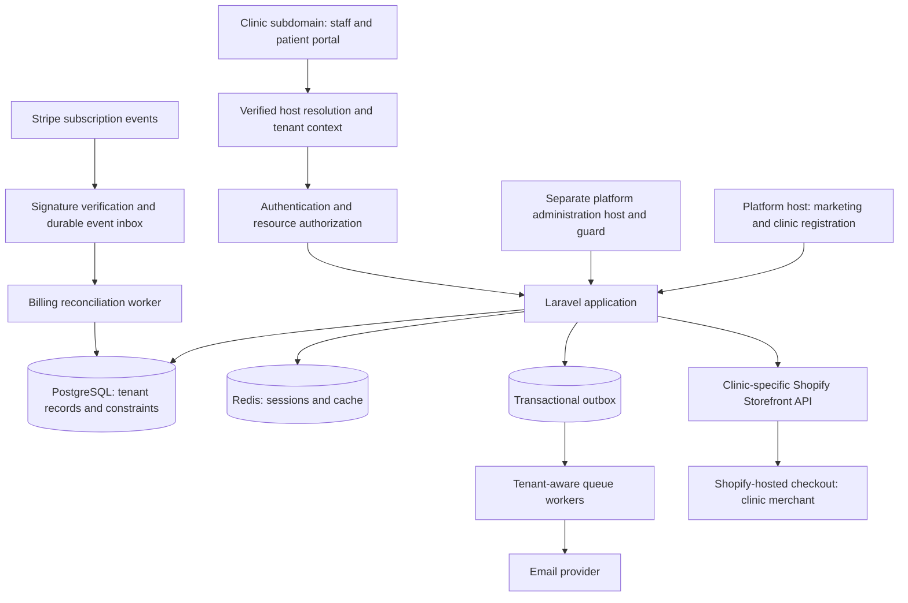

# SmileSuite: B2B SaaS System and Implementation Plan — v2

**Multi-tenant dental scheduling, patient intake, and clinic-owned Shopify storefronts**  
**Revision date:** October 26, 2026  
**Status:** Revised proposal for review; implementation and launch are not represented as approved or completed.  
**Supersedes for planning:** `smilesuite_system_plan.md`; preserve that original file.

## 1. Purpose, business model, and revision decisions

SmileSuite sells subscription software to independent dental clinics. Each clinic controls its own staff, appointments, patient records, branding, and Shopify store. Patients use a clinic-specific portal for booking and intake, then use that clinic's Shopify checkout for retail purchases.

The platform owner receives SaaS subscription revenue. Each clinic remains responsible for its products, inventory, fulfillment, returns, and merchant payment arrangements. SmileSuite does not warehouse goods. Appointment fees are paid directly at the clinic in the MVP; SmileSuite does not collect clinical deposits in this release.

This revision retains the original product direction and resolves the architectural gaps identified in review. The following are **proposed working defaults introduced by this revision**, not previously confirmed business commitments:

- One physical clinic location and one optional Shopify connection per tenant.
- Tenant-local accounts with multiple permitted roles; separate platform administrator accounts.
- Laravel 13, PHP 8.4, and PostgreSQL 16 across development, CI, staging, and production.
- Pay-at-clinic appointments; no online deposits or prescription workflow in the MVP.
- Merchant-managed Shopify Headless credentials for the MVP; no SmileSuite-distributed Shopify app or Admin API token requirement.
- Shopify-hosted customer account links for purchases; integrated purchase history and single sign-on are deferred.
- Custom domains, SMS, and advanced recommendations are later releases. Clinic subdomains and email notifications are MVP features.

Business choices still requiring an accountable decision are recorded in Section 12. They do not prevent synthetic-data development of independent modules, but their listed gates prevent unapproved payment, health-data, or public launch activity.

## 2. Release scope and success criteria

| Capability | MVP | Later release / condition |
| :--- | :--- | :--- |
| Clinic onboarding | Clinic profile, owner account, unique subdomain, subscription | Multi-location organizations |
| Clinic operations | Staff invitations, multiple roles, chairs, services, shifts, breaks, closures, leave | Complex equipment or assistant scheduling |
| Appointments | One patient, service, practitioner, and chair per appointment; safe booking/rescheduling/cancellation | Group bookings and multi-stage treatments |
| Patient portal | Verified account, own appointments, versioned intake, own submitted intake history | Approved clinical record release workflow |
| Clinical records | Assigned-practitioner access to intake; separate, versioned encounter notes | Prescriptions, imaging, full dental charting, insurance |
| Payments | Clinic-to-platform SaaS subscriptions; appointment payment at clinic | Deposits, refunds, clinical payment collection |
| Commerce | Optional Shopify catalog, cart, hosted checkout, clinic customer-account link | Embedded order history, cross-system customer identity |
| Recommendations | Public clinic-authored product information | Patient-specific bundles, automated treatment cross-sell |
| Domains and delivery | Platform clinic subdomains; queued email and calendar attachments | Custom domains and consented SMS |

MVP acceptance requires: two synthetic clinics remain isolated across all supported access paths; simultaneous conflicting booking attempts yield exactly one appointment; subscription events converge correctly after duplicates or reordered delivery; each storefront uses its own store; an outage of commerce does not prevent clinical booking; a backup can be restored within the approved recovery objectives.

No launch date, price, staffing commitment, participant outcome, or regulatory approval is established by this plan.

## 3. Technical architecture and dependency policy

Use a modular Laravel application with explicit domains: tenancy/identity, clinic configuration, scheduling, clinical records, billing, commerce, and notifications/operations. Shared code carries identifiers and contracts; it must not bypass a domain's authorization rules.

| Layer | Proposed baseline | Required verification |
| :--- | :--- | :--- |
| Application | Laravel 13.x; PHP 8.4 latest patched release | Resolve a compatible Cashier/package set before scaffolding; commit lockfiles |
| UI | Blade, Tailwind CSS, Alpine.js, Vite | Pin compatible versions; verify accessible keyboard and mobile flows |
| Database | PostgreSQL 16 latest minor; `btree_gist` extension | Same major/extension in all integration environments; no SQLite substitution for database tests |
| Cache/session/queue | Supported, maintained Redis release and Laravel queue workers | Isolate environment credentials, keys, queue access, and tenant context |
| Billing | Compatible maintained Laravel Cashier (Stripe) release | Record exact package and supported Stripe API/webhook versions in the dependency manifest |
| Commerce | Shopify Storefront GraphQL API `2026-10` | Contract-test this version; record served version and review quarterly |
| Storage | Private object storage for protected records; separate public branding assets | Authorize protected downloads; validate and re-encode permitted branding images |
| Notifications | Laravel queues, email provider, generated `.ics` | Verified sender setup, retries, deduplication, and minimal message content |

Laravel 11 security support ended March 12, 2026. Laravel 13 supports PHP 8.3–8.5 and has a longer remaining support window; this plan selects PHP 8.4 as an implementation choice. See the [Laravel support policy](https://laravel.com/docs/13.x/releases#support-policy).

Record exact dependency versions during Phase 1 rather than claiming an untested combination works. Review security advisories during development and before release. Plan upgrades before support expires. Shopify publishes versioned API releases and support windows; use explicit versions and test migration before changing them. See [Shopify API versioning](https://shopify.dev/docs/api/usage/versioning).

## 4. Tenant identity, authorization, and isolation

### 4.1 Host resolution and context lifetime

1. Normalize the host, trust forwarding headers only from configured proxies, and match a registered platform host or an exact clinic subdomain under the configured platform domain. Reject unknown hosts; never fall back to a default clinic. Resolve registered tenants before applying lifecycle and billing restrictions so permitted record access for restricted clinics remains possible.
2. Reserve platform names such as `www`, `admin`, `api`, and `support`. Enforce normalized subdomain uniqueness at the database layer, including concurrent registration attempts.
3. Bind an immutable `TenantContext` for the request/job lifecycle using Laravel scoped bindings. Resolve it before tenant model binding or account lookup. A missing context on a tenant operation raises an error; it must never remove the filter and expose all tenants.
4. Jobs carry a validated tenant identifier and primitive resource IDs. Establish context before loading tenant models; clear it in a `finally` block. Avoid serializing tenant Eloquent models into jobs that restore before context exists. Scheduled commands iterate explicit tenants. No worker retains a previous tenant or Shopify client between jobs.
5. Stripe ingestion is a platform endpoint. It resolves billing ownership from verified provider identifiers, not a supplied subdomain or payload `tenant_id`.

Laravel documents `scoped` bindings as request/job-lifecycle bindings; use that lifetime rather than a tenant singleton in long-lived processes. See [Laravel service container](https://laravel.com/docs/13.x/container#binding-scoped-singletons).

### 4.2 Account and role model

- `platform_admins` is a separate identity table and authentication guard. Platform administration manages operational metadata and billing; it grants no routine patient-record access.
- Clinic `users` have a mandatory `tenant_id`. Normalize email and enforce uniqueness on `(tenant_id, email)`. A person attending two clinics has two clinic accounts in this MVP; records are never linked automatically by email.
- A tenant-scoped `user_roles` relation supports owner, practitioner, receptionist, and patient roles together. Platform roles cannot be assigned through clinic administration.
- A `practitioner` is a clinic user with an active practitioner role. A `patient_profile` may initially have no user for a walk-in. Account linking requires verified control plus a clinic-approved matching process; email equality alone is insufficient.
- Password reset, invitation, account verification, and login all bind to the clinic and canonical host. Use host-only, Secure, HttpOnly session cookies; do not share a parent-domain session cookie across clinic and administrator hosts. Require MFA for staff and platform administrators.

| Action | Platform admin | Clinic owner | Assigned practitioner | Receptionist | Patient |
| :--- | :--- | :--- | :--- | :--- | :--- |
| Platform billing/tenant metadata | Authorized platform scope | Own clinic billing only | No | No | No |
| Clinic branding, staff, services | No routine edit | Yes | Own availability; approved service access | Delegated scheduling configuration | No |
| Appointment operations | No routine access | Operational access | Assigned appointments | Clinic scheduling access | Own appointments only |
| Medical intake and encounter notes | No routine access | Only with separately authorized clinical role | Assigned-care access | No clinical content | Own submitted intake; no automatic internal-note access |
| Shopify connection | No secret viewing | Manage own clinic connection | No | No | No |

All actions require resource-level policies as well as a role. Record access assignment and role changes. Any future emergency clinical-access mechanism requires a separate design and audited justification; there is no unrestricted super-admin chart bypass in the MVP.

### 4.3 Enforcement at each boundary

- Keep automatic Eloquent tenant scopes, but also set `tenant_id` from trusted context on insert and reject attempts to change it. Apply resource authorization on reads and writes.
- Enforce tenant-consistent relationships with composite foreign keys: for example, `(tenant_id, patient_id)` references `patient_profiles(tenant_id, id)`. Add corresponding unique keys on referenced pairs. Apply the same pattern to practitioners, chairs, services, notes, and tenant-scoped pivots.
- Raw SQL and bulk operations require explicit tenant predicates. Allowlisted platform repositories may access only their documented metadata; general `withoutGlobalScopes()` use is prohibited.
- Cache keys include environment, tenant, connection generation, locale/currency where applicable, query, and pagination. Private pages and clinical responses are not placed in shared HTTP/CDN caches.
- Authorize file downloads and exports against tenant and resource ownership. Prefixing a storage path or guessing an object ID is not authorization.
- Put tenant identifiers in operational audit records, not clinical content in application logs. Apply tenant-aware request and background-work limits.

These controls implement the plan's own isolation design. [OWASP's multi-tenant security guidance](https://cheatsheetseries.owasp.org/cheatsheets/Multi_Tenant_Security_Cheat_Sheet.html) covers context, database, cache/session, asynchronous work, and storage boundaries.

### 4.4 Custom domains — later release

Use a unique `tenant_domains` registry, not a free-form fallback column. Verify DNS ownership with an expiring challenge before activation; provision and renew a certificate before serving the host. Unknown, duplicate, expired, or unverified domains do not resolve to a tenant. Document DNS removal, domain reassignment, session behavior, and certificate failure handling. Do not advertise custom domains as an MVP entitlement.

## 5. Data model and invariants

This is a logical model. Phase 1 produces reviewed migrations, indexes, delete policies, and schema tests before feature work depends on them. Unless explicitly marked platform-wide, every table includes `tenant_id`, timestamps, and tenant-consistent keys.

### 5.1 Core tables

| Table | Key fields / relationships | Invariants |
| :--- | :--- | :--- |
| `tenants` | Platform registry: id, name, subdomain, timezone, currency, lifecycle_status, branding, Stripe customer fields | Unique normalized subdomain; valid IANA timezone; billing status separate from lifecycle status |
| `platform_admins` | Platform identity: email, password hash, MFA, status | Separate guard; no clinic role assignment |
| `users` | id, tenant_id, name, normalized email, password hash, verified_at, status | Unique tenant/email; tenant cannot be reassigned |
| `user_roles` | tenant_id, user_id, role | Unique tenant/user/role; allowlisted roles |
| `staff_invitations` | tenant_id, email, roles, token_hash, expires_at, accepted_at | Single use, tenant-bound, expiring; no plaintext token storage |
| `patient_profiles` | id, nullable user_id, contact/demographic fields, emergency contact | At most one linked profile per tenant/user; protect sensitive fields |
| `practitioners` | id, user_id, display title, specialization, active | One practitioner record per tenant/user; active clinical role required |
| `operatories` | id, name, active | Historical appointments retain their chair reference |
| `services` | id, name, category, description, duration_minutes, buffer_before_minutes, buffer_after_minutes, price_minor, currency, active | Positive duration; nonnegative buffers/prices; no deposit configuration in MVP |
| `practitioner_services` | practitioner_id, service_id | Tenant-consistent eligibility; unique pair per tenant |
| `operatory_services` | operatory_id, service_id | Tenant-consistent chair compatibility; unique pair per tenant |
| `clinic_hours` | weekday, local_start, local_end, effective_from/to | Local recurring hours in tenant timezone; split overnight hours into dated segments |
| `practitioner_shifts` | practitioner_id, weekday, local_start/end, effective_from/to | Recurring availability; invalid/ambiguous local-time handling defined below |
| `practitioner_breaks` | practitioner_id, weekday, local_start/end, effective_from/to | Recurring unavailable intervals |
| `schedule_blocks` | resource_type: clinic/practitioner/operatory, resource_id, starts_at, ends_at | Dated closures, leave, maintenance, and overrides; clinic blocks have no resource_id; validate typed references |
| `appointments` | id, public_code, patient_id, practitioner_id, service_id, operatory_id, start_at, end_at, occupied_start_at, occupied_end_at, status, price_minor, currency, duration/buffer snapshots, version | UTC instants; one service/practitioner/chair; no overlaps for either resource; immutable price/duration snapshots unless explicit audited reschedule |
| `appointment_events` | appointment_id, actor identity, prior/new state, reason code, occurred_at | Append-only state/change audit; no medical narrative |
| `idempotency_requests` | actor scope, operation, key_hash, request_hash, result_resource_id, expires_at | Unique tenant/actor/operation/key; mismatched request replay rejected |

`schedule_blocks` resource targets need explicit validation because a polymorphic ID alone cannot enforce all foreign keys. Use separate target columns with tenant-consistent foreign keys and a check that exactly the permitted target is set, or separate resource-specific block tables in the physical schema.

### 5.2 Clinical, integration, and operational tables

| Table | Key fields / relationships | Invariants |
| :--- | :--- | :--- |
| `intake_submissions` | patient_id, optional appointment_id, form_version, encrypted answers, submitted_at, author, supersedes_id | Versioned records; amendment creates a new version; no clinical content in appointment list responses |
| `clinical_notes` | patient_id, appointment_id, practitioner_id, encrypted content, note_version, signed_at, supersedes_id | Separate clinical policy; signed notes are amended by new versions, not overwritten |
| `care_assignments` | patient_id, practitioner_id, optional appointment_id, granted_by, valid_from/to, revoked_at, purpose | Explicit, audited clinical delegation; current appointment assignment provides its own scoped access; revoked assignments grant no further access |
| `consent_records` | patient_id/user_id, purpose, notice_version, granted/withdrawn_at, capture_method | Purpose-specific evidence; marketing permission separate from care-related processing |
| `shopify_connections` | tenant_id unique, shop_domain, encrypted_private_storefront_token, api_version, generation, state, verified_at, last_error_code | One connection per tenant; no Admin API token in MVP; tokens never returned by read APIs |
| `shopping_carts` | opaque local id, nullable user_id or session reference, shopify_cart_id encrypted, connection_generation, expires_at | Tenant/session-bound; invalidate after connection replacement; no health metadata |
| `subscriptions`, `subscription_items` | Cashier-compatible fields and tenant ownership | Publish/adapt actual package migrations; preserve required identifiers, statuses, prices, quantities, trials, cancellation fields |
| `billing_entitlements` | tenant_id unique, plan_code, practitioner_limit, operatory_limit, source_revision, effective_at | Derived from reconciled billing state; server-enforced limits |
| `webhook_events` | Platform inbox: provider, event_id, mapped tenant_id, payload_reference, processing state, attempts | Unique provider/event_id; verified before acceptance; protected payload storage and explicit retention |
| `outbox_messages` | tenant_id, event type, resource_id, version, delivery state, deduplication key | Written with business transaction; recoverable dispatch; no plaintext medical payload |
| `notification_deliveries` | tenant_id, outbox_id, channel, attempt/status, provider_reference | Per-event deduplication and retry history; redact recipient/message data in ordinary logs |
| `audit_events` | actor type/id, tenant_id, action, resource type/id, result, timestamp, request reference | Append-only, restricted access; no secrets or chart contents |

### 5.3 Database rules

- Store monetary amounts as integer minor units with an ISO currency code. Conversion/formatting is currency-aware; do not assume every currency has two decimal places.
- Intake/notes linked to an appointment must refer to that appointment's patient. Enforce a composite appointment/patient reference in addition to tenant foreign keys. Authorization also checks the current user's own profile or current care assignment, so another patient within the same tenant cannot be substituted.
- Persist appointment and block instants as timezone-aware UTC values; preserve the clinic timezone used to interpret local schedule rules.
- Enforce `start_at < end_at` and `occupied_start_at <= start_at < end_at <= occupied_end_at` using checks. Occupied ranges include service buffer snapshots.
- Use two PostgreSQL GiST exclusion constraints, one on tenant/practitioner/occupied range and one on tenant/operatory/occupied range, for rows whose status is not `cancelled`. Use half-open `tstzrange` intervals `[start, end)` with `btree_gist` equality support. Boundary-adjacent occupied ranges are allowed; overlapping ones are rejected.
- Retain occupied ranges for completed and no-show appointments to preserve schedule history; a cancellation releases the reservation. Any future early-release workflow needs an explicit audited change, not a silent status shortcut.
- Do not cascade-delete clinical history when a staff account, chair, service, or tenant is deactivated. Restrict destructive deletes and follow the approved retention/offboarding procedure.
- Index tenant/date/resource scheduling queries and tenant-scoped identity lookups. Benchmark representative synthetic data before launch.

PostgreSQL documents range-based exclusion constraints for non-overlapping reservations. The choice to apply them to both SmileSuite resources is this plan's design. See [PostgreSQL range constraints](https://www.postgresql.org/docs/16/rangetypes.html#RANGETYPES-CONSTRAINT).

## 6. Appointment and clinical workflows

### 6.1 Availability rules

An offered slot is advisory until the reservation transaction commits. It must satisfy clinic hours, practitioner shifts, breaks, dated blocks, practitioner-service eligibility, chair-service compatibility, and both resources' occupied intervals.

Use a proposed 15-minute start-time grid, configurable per clinic. Service duration is independent of the grid. Proposed service buffers default to 0 minutes before and 15 minutes after; clinics must confirm appropriate values before use. The full occupied interval must fit available hours and avoid blocks. These are scheduling defaults, not clinical sterilization claims.

Generate dates and recurring hours in the clinic's IANA timezone, then convert to UTC. Reject nonexistent daylight-saving times. When a local time is ambiguous, present/select an explicit offset; do not silently choose one. Split overnight hours into dated intervals. Never reinterpret an existing appointment when the clinic later changes its timezone or service duration.

Before enabling self-service booking, configure a booking horizon, minimum lead time, and cancellation window. Proposed defaults are 90 days, 2 hours, and 24 hours respectively. Staff may override lead/cancellation windows with a recorded reason, but may not override resource conflicts or tenant ownership.

### 6.2 Atomic booking and idempotency

1. Require a verified patient account for self-service booking; rate-limit slot lookup and booking. Receptionists can create a tenant-local walk-in profile without inventing an account.
2. Validate a tenant-bound request with a client idempotency key. Reject reused keys carrying different booking details; replay the original result for identical retries by the same actor and operation.
3. Begin a PostgreSQL transaction. Lock the tenant scheduling guard row, then practitioner and chair rows in a consistent order. All appointment, shift, break, closure, service-buffer, and eligibility mutations use the same guard protocol so a schedule change cannot race a booking. This conservative per-clinic serialization is an MVP design choice; measure throughput before introducing finer locks.
4. Recheck the idempotency record under the tenant lock before any insertion, then recheck tenant lifecycle/entitlements, patient ownership, active service/resources, eligibility, hours, blocks, price, buffers, and live overlaps. For “first available,” choose candidates deterministically and revalidate the actual selected pair. Keep successful idempotency results for a proposed minimum of 24 hours; expiry and retry behavior must be visible to clients.
5. Insert the appointment, event, idempotency result, and notification outbox entry in the same transaction. Both resource exclusion constraints remain the final collision backstop.
6. Commit before dispatching external work. On a conflict, roll back and return “slot no longer available” with refreshed choices. Use bounded deadlock/serialization retries with the same idempotency key; never create an untracked duplicate.

**Required proof:** two truly concurrent database connections attempting an overlapping appointment for the same practitioner or chair yield one committed reservation and one conflict. A sequential unit test is not sufficient.

### 6.3 Appointment states and changes

Default transitions: `scheduled -> confirmed -> checked_in -> in_chair -> completed`. Authorized staff may check in a scheduled appointment directly, mark scheduled/confirmed appointments `no_show` after their start, or cancel scheduled/confirmed/checked-in appointments with a reason. Patients may cancel their own scheduled/confirmed appointments within the configured window. Terminal records require a documented correction workflow; patients cannot mark completion or no-show.

Reschedule scheduled/confirmed appointments atomically under the same locks and constraints, preserving an audit event and incrementing `version`. A stale version is rejected so concurrent staff edits do not overwrite one another. Generate calendar updates/cancellations with stable UID and increasing sequence. Store scheduled timing separately from actual check-in/chair/completion timestamps.

### 6.4 Clinical records and communications

Patients submit versioned intake through authenticated pages. Only assigned practitioners or practitioners with a valid explicit `care_assignments` record can read clinical content. Clinic owners and receptionists receive operational views without medical answers or encounter notes. Practitioner reassignment updates access and is audited. Historical access beyond the current appointment requires an active care assignment under the approved records-access policy.

Audit clinical reads, exports, amendments, and role changes without copying medical text into the audit trail. Internal notes are separated from patient-submitted intake; any patient access/export of internal clinical notes follows the applicable, approved records-release process.

Email and calendar content contains only the minimum appointment information approved for the delivery provider. No treatment detail, allergies, diagnosis, or clinical narrative is placed in subjects, `.ics` descriptions, URLs, or analytics. Email links open authenticated portal pages. Provider failure does not roll back a confirmed booking; staff can see notification delivery status. Exactly-once external email delivery is not guaranteed, so retries use provider idempotency where available and delivery records to minimize duplicates.

## 7. SaaS subscriptions and entitlements

### 7.1 Ownership and Cashier mapping

The **Tenant** is the billable model. Configure Cashier's custom customer model and adapt its published migrations to the tenant model. Keep the package-compatible subscriptions and subscription-items structure; the original abbreviated `tenant_subscriptions` table is not a replacement. Maintain separate derived entitlements rather than duplicate competing subscription truth. See [Cashier billable models and migrations](https://laravel.com/docs/13.x/billing#billable-model).

Proposed tiers retain the original resource limits: Starter permits 1 chair and 2 active practitioners; Pro permits 5 chairs with no contractual practitioner seat cap. Technical abuse/fair-use limits still apply. Monthly/annual prices, currency, taxes, trials, and fair-use terms require business approval. Multi-location Enterprise and custom domains are not sold as available MVP capabilities.

Clinic registration reserves the subdomain and owner atomically in a pending onboarding state. Stripe customer/subscription creation uses idempotency keys and stable local references. Abandoned onboarding expires by policy. A browser success redirect alone does not activate paid entitlements.

### 7.2 Subscription event processing

- Verify Stripe signatures on the raw body using the configured endpoint secret. Accept only expected event types and resolve the tenant by stored customer/subscription identifiers. Unknown mappings are quarantined and investigated, never attached by customer email.
- Persist the verified event durably with a unique provider/event ID before returning success. Process asynchronously with per-subscription serialization, retries, and alerting. Limit retained raw payloads to the approved retention period.
- Treat events as triggers to reconcile current provider state. Do not rely on arrival order or event timestamp to overwrite newer subscription state. Record reconciliation failures and run scheduled reconciliation at least daily.
- Derive entitlements consistently from current subscription state. Pending/incomplete subscriptions do not obtain paid access. Proposed policy: a 7-day past-due grace period, then block new bookings and commercial configuration while authorized staff retain existing appointment operations and permitted record access/export. Confirm this policy before live billing; nonpayment never automatically deletes clinical records.
- Enforce chair/practitioner limits on the server under a tenant lock. Check resource counts before allowing an in-app downgrade to be scheduled for period end. If a provider-side downgrade or cancellation nevertheless leaves the clinic over limit, restrict creation of new resources/bookings according to policy while preserving existing appointment operations and permitted record access. Never silently delete records or continue old paid entitlements indefinitely; flag the condition for resolution.

Stripe documents duplicate deliveries and lack of event ordering. Tests must cover both, failed processing, and recovery. See [Stripe webhook guidance](https://docs.stripe.com/webhooks).

### 7.3 Appointment payments — explicit boundary

MVP appointment `payment_method` is `pay_at_clinic`. It is not a claim that payment has been received. Do not store a fake `deposit_paid` preference or offer a deposit button.

A future deposit release requires a separate decision on the legal payment recipient, merchant onboarding, provider availability, taxes/receipts, payment-intent records, currency/amount validation, signed events, expiring slot holds, reconciliation, refunds, chargebacks, and cancellation policy. SaaS billing and clinical payments must not share an ambiguous transaction ledger.

## 8. Clinic-owned Shopify commerce

### 8.1 MVP connection lifecycle

The clinic owns an active Shopify store and configures its Headless channel, publishes products to that storefront, and supplies its private Storefront token through an owner-only settings form. SmileSuite calls Shopify server-side. This is merchant-managed headless configuration; SmileSuite is not assuming approval to distribute a Shopify app.

Validate a canonical single-label `*.myshopify.com` shop hostname, reject schemes/paths/userinfo/ports and arbitrary hosts, and construct the HTTPS API endpoint server-side. Do not follow arbitrary redirects during connection tests. Verify the intended shop through a scoped API request before activating the connection. Enforce one active tenant association per shop by default; any shared-store exception needs a separate ownership design.

Encrypt the private token using managed, versioned keys; show only connection status and a masked identifier after save. Restrict secret retrieval to the server integration, redact logs/exceptions, and document rotation and recovery. Revocation or failed authentication changes connection state and prompts the owner to reconnect. Replacement increments `generation` and invalidates catalog and cart state for the old connection.

Private Storefront tokens must remain server-side. Buyer-triggered server requests include `Shopify-Storefront-Buyer-IP` derived through trusted proxy configuration. Follow the documented private-token header and least-scope setup. See [Storefront authentication](https://shopify.dev/docs/api/storefront/latest#authentication).

If automated installation, Admin API features, or app distribution is added later, first design OAuth/token lifecycle, merchant consent, uninstall handling, required privacy webhooks, and applicable distribution/billing requirements. Shopify distinguishes public distribution for many merchants from constrained custom distribution; one custom app installation is not a universal onboarding solution. See [Shopify distribution](https://shopify.dev/docs/apps/launch/distribution).

### 8.2 Catalog, cart, and checkout

- Cache public catalog responses for up to 30 minutes using tenant, connection generation, API version, market/currency, locale, and pagination/query keys. Invalidate on reconnection/manual refresh; caching reduces requests but does not guarantee rate-limit avoidance or current inventory.
- Treat Shopify as authoritative for product variants, availability, prices, currency, shipping, tax, and final checkout totals. Identify cart merchandise by variant ID, not product ID alone. Never trust browser-submitted prices.
- Maintain a tenant/session-bound cart and use `cartCreate`, `cartLinesAdd`, `cartLinesUpdate`, and `cartLinesRemove` as needed. Handle GraphQL errors and `userErrors`, stock changes, expired carts, throttling, and timeouts. Do not blindly retry a non-idempotent mutation and add duplicate lines.
- Fetch the cart's returned `checkoutUrl` and redirect to that Shopify-generated destination; never construct a checkout path from an example URL. See [Shopify Cart](https://shopify.dev/docs/api/storefront/latest/objects/Cart).
- Do not interpret a redirect or browser return as proof of payment. Retail fulfillment, returns, and customer receipts remain in the clinic's Shopify workflow.
- When Shopify is unavailable, show an honest storefront error and preserve recoverable cart state where possible. Clinic scheduling and existing patient records remain usable.

No intake, clinical notes, patient-specific treatment labels, or health identifiers are sent in Shopify cart attributes, notes, analytics events, or recommendation links. Product choices themselves may imply health interests, so the data-flow/provider review in Section 9 must assess the commerce boundary as well.

### 8.3 Patient purchases and deferred recommendations

MVP patient pages link to the clinic's verified Shopify-hosted customer account experience, with a clear notice that purchases use the clinic store's sign-in. SmileSuite does not store order history, infer customer identity from a matching email, or promise shared login.

Embedded purchase history later requires an explicit customer authentication and account-linking design, such as Shopify's Customer Account API, including tenant-bound OAuth state, token storage, logout, consent, and scope review. The API authenticates buyers and exposes their account data; it does not automatically inherit SmileSuite authentication. See [Customer Account API](https://shopify.dev/docs/api/customer/latest).

Patient-specific product bundles and treatment-triggered cross-sell are deferred until clinical/content review and provider data-sharing decisions are complete. Future recommendations require variants, quantities, author, tenant, expiry/revocation, recipient authorization, and a delivery audit. Use opaque expiring portal links; do not put a patient's condition or identifier into a retail URL. Retail recommendations are not prescriptions.

## 9. Health-data governance and operational security

Before real patient data is accepted, the accountable clinic/platform team must approve a data inventory and flow map, operating countries, controller/processor responsibilities, lawful processing basis, notices, provider agreements, hosting region, access policy, retention schedule, deletion exceptions, and records-request process. This plan makes no claim of compliance with a particular health/privacy law or provider certification.

Required controls:

1. Encrypt transport, database/storage volumes, backups, protected clinical fields, and private integration credentials. Separate environments and access keys. Document key rotation, authorization to decrypt, and disaster recovery of keys; encryption without recoverable keys is not a backup strategy.
2. Use synthetic records in development and testing. Do not copy live clinical records into fixtures, logs, AI chats, analytics, or developer machines. Only minimal operational metrics leave protected clinical systems.
3. Require verified staff identities, MFA, invitation expiry, session expiry/revocation, least privilege, and prompt offboarding. Limit and audit production support access. Prohibit shared staff accounts.
4. Capture privacy notices and communication preferences with versions and timestamps. Keep marketing opt-in separate. Define guardian identity, consent, and account access before allowing minors/dependent booking; that workflow is not enabled by default. Enforce the approved eligibility policy before any unsupported patient's intake is collected.
5. Use append-only audit events for clinical access and changes, role changes, exports, billing actions, and integration changes. Audit failures in protected workflows must have a defined fail-safe response; do not silently discard mandatory audit evidence.
6. Disable third-party advertising/session-replay scripts on authenticated clinic pages. Configure error reporting to exclude request bodies, medical content, tokens, cart secrets, and credentials.
7. Approve retention by data category, including clinical versions, consent evidence, audit records, provider payloads, exports, and backups. Tenant cancellation deactivates access according to policy; it is not permission to erase records immediately.
8. Prepare incident triage, access revocation, breach-assessment responsibility, provider escalation, and notification procedures for the chosen jurisdictions. Assign named operational owners before pilot access.

Protected application data must be stored in approved access-restricted infrastructure; do not use this planning document's location as patient-record storage.

## 10. Seven-phase implementation roadmap

Checkboxes describe future work and start unchecked. Each phase owns its security and regression tests; Phase 7 validates the integrated release rather than introducing security for the first time. Effort labels are comparative planning judgments, not calendar estimates; assign engineers and estimates after the Phase 1 dependency/schema check.

| Phase | Deliverable | Depends on | Relative effort | Accountable role to assign |
| :--- | :--- | :--- | :--- | :--- |
| 1 | Tenant-safe foundation and schema | Working defaults and architecture decisions | High | Technical lead |
| 2 | Clinic configuration and scheduling resources | 1 | Medium | Application lead |
| 3 | Atomic booking and patient intake | 1–2; health-data gate before real records | High | Scheduling/clinical lead |
| 4 | Subscription onboarding and entitlements | 1–2; billing decisions before live charges | Medium–high | Billing lead |
| 5 | Optional Shopify storefront | 1–2; merchant setup and provider review | Medium | Commerce lead |
| 6 | Integrated staff/patient experience and notifications | 3–5 | Medium | Product/application lead |
| 7 | Recovery, accessibility, security, and controlled pilot | 1–6; all launch gates | High | Release/operations lead |

### Phase 1 — Tenant foundation and database invariants

- [ ] Record exact framework/PHP/package versions and prove Cashier compatibility in an isolated development setup; document any change to this baseline.
- [ ] Create PostgreSQL migrations, extension setup, composite tenant foreign keys, appointment checks/exclusion constraints, separate platform identities, tenant-local roles, audit/outbox/inbox tables, and reviewed delete policies.
- [ ] Implement exact-host resolution, scoped context, account/reset/invitation scoping, host-only sessions, resource policies, private file authorization, and tenant-aware job/command entry points.
- [ ] Establish CI against PostgreSQL and Redis with two synthetic tenants.
- [ ] **Gate:** tenant A cannot read, write, link, export, or download tenant B data through HTTP, raw-query repositories, jobs, or storage; missing tenant context fails closed; sequential jobs for A then B do not retain context; direct cross-tenant FK writes fail.

### Phase 2 — Clinic setup and resource calendars

- [ ] Build branding/contact settings, service snapshots/defaults, chairs, practitioners, invitations/roles, eligibility pivots, clinic hours, shifts, breaks, and dated blocks.
- [ ] Apply the tenant scheduling guard to every mutation that changes availability. Reject changes conflicting with existing appointments unless explicitly resolved through the reschedule/cancel workflow.
- [ ] Implement resource-limit enforcement and auditable deactivation rather than destructive historical deletes.
- [ ] **Gate:** a break, holiday, leave period, incompatible chair, ineligible practitioner, inactive resource, or buffer outside working hours removes the slot; invalid daylight-saving input is rejected and ambiguous input is explicit; role escalation is denied.

### Phase 3 — Booking, state changes, and protected records

- [ ] Build availability lookup, verified patient booking, receptionist walk-in workflow, atomic reservation/idempotency, rescheduling with version checks, cancellation, and status audit.
- [ ] Build versioned intake and separate encounter notes with assigned-care authorization and clinical-read audit.
- [ ] Write a transactional outbox event for each committed appointment change.
- [ ] **Gate:** true parallel bookings collide correctly for both chair and practitioner; cancelled slots reopen; completed/no-show history retains its range; identical request replay returns the same appointment; stale edits fail; failed transactions create neither bookings nor notification events; receptionist/owner-only roles cannot read charts.

### Phase 4 — Clinic SaaS onboarding and billing

- [ ] Implement pending clinic registration, subdomain reservation, Tenant billable model, Cashier migrations, approved plan/price mapping, billing portal authorization, verified durable webhook ingestion, serialized reconciliation, and daily repair jobs.
- [ ] Implement derived entitlements, approved trial/grace/downgrade policy, and preserved record access under billing restrictions.
- [ ] **Gate:** signed duplicates, reordered events, unknown tenants, provider timeouts, abandoned checkout, payment failure, cancellation, and over-limit downgrade converge to the approved state; a success URL does not grant access; one clinic cannot open another clinic's billing portal.

### Phase 5 — Shopify catalog and hosted checkout

- [ ] Build owner-only merchant-managed connection, hostname validation, secret encryption/rotation, catalog cache, tenant/session cart, mutation error handling, and returned checkout URL redirect.
- [ ] Provide synthetic contract fixtures and a clearly labeled sandbox mode; require a real authorized test-store contract run before enabling live commerce.
- [ ] **Gate:** two stores return distinct catalogs/carts; invalid endpoints and cross-tenant cart IDs are rejected; credentials stay server-side; revoked/replaced tokens invalidate connections safely; variant stock/price changes are handled; Shopify failure leaves clinical booking operational; no clinical fields reach commerce requests.

### Phase 6 — Staff/patient integration and delivery

- [ ] Complete staff schedule views, status operations, patient appointment/intake pages, clinic retail account links, and permission-filtered responses.
- [ ] Implement recoverable outbox dispatch, queued email, stable calendar UID/sequence, notification status, bounded retries, and failed-delivery visibility. Use polling with version checks for the MVP dashboard; cross-tenant push channels are not introduced implicitly.
- [ ] **Gate:** scheduled/updated/cancelled appointments generate the correct calendar event; queue outage does not lose the committed outbox event; replay does not create a new appointment; emails contain no clinical detail; patient A cannot view patient B even within the same clinic; commerce login is labeled separately.

### Phase 7 — Release verification and controlled pilot

- [ ] Execute the full two-tenant access matrix, database concurrency suite, billing replay/recovery tests, commerce contract tests, and full user journeys.
- [ ] Verify keyboard navigation, labels/errors, focus, contrast, responsive reflow, and target WCAG 2.2 AA using automated checks plus manual assessment; record findings rather than claiming certification from a scan.
- [ ] Load-test booking, availability, tenant limits, and queue recovery with representative synthetic workloads. Confirm the per-clinic lock is adequate and publish measured capacity limits.
- [ ] Restore database, protected objects, and encryption keys in an isolated environment and reconcile outbox/billing state after recovery. Revoke restored sessions before any recovered production service is exposed.
- [ ] Prove DNS/TLS provisioning, deployment/rollback, monitoring/alerts, incident runbooks, offboarding/export, and retention controls. Assign owners and close Section 12 gates.
- [ ] **Gate:** no unresolved cross-tenant or unauthorized clinical-access defect; all required evidence is saved; pilot clinics and responsible release owner explicitly authorize the controlled release. No approval is presumed by this document.

## 11. Production operations and evidence

- Use separate credentials and isolated data stores per environment, private database/Redis access, least-privilege runtime identities, and a separately controlled migration identity. Restrict administrator-host access and audit privileged actions.
- Keep CSRF protection on browser state-changing routes; exempt only designated provider endpoints with their own verified signatures. Apply server-side allowlist validation, safe output escaping/sanitization, restrictive security headers, upload limits, and rate limits. Test reset/invitation abuse, unauthorized role changes, and untrusted URLs; enforce authorization again at the destination of every signed link.
- Provision wildcard subdomain DNS and certificates, verify renewal, monitor expiration, and reject unknown hosts at both proxy and application layers. Custom-domain support remains a separate release.
- Supervise queue workers and the scheduler; alert on queue age, failed jobs, outbox backlog, webhook processing failures, provider authentication errors, backup failure, and certificate expiry. Do not log patient names or chart text in alerts.
- Proposed recovery objectives: **RPO at most 15 minutes, RTO at most 4 hours**. These are planning targets, not demonstrated capabilities. Select a database point-in-time recovery/storage backup design capable of meeting them, assign an operator, and prove a restore before launch. Backup retention remains subject to Section 12.
- Use backward-compatible migration/deployment steps where possible. Document application rollback and database forward-repair procedures; a backup restore is not the routine rollback for a code release. Maintain the inbox/outbox and external-provider reconciliation boundary through recovery.
- Keep a release evidence bundle containing migration/constraint results, isolation matrix, concurrent booking output, billing replays, authorized Shopify contract results, accessibility findings, measured performance, restore timing, dependency manifest, and outstanding exceptions with owners.

## 12. Decision register and launch gates

| ID | Decision / evidence needed | Responsible role | Gate |
| :--- | :--- | :--- | :--- |
| D1 | Confirm MVP defaults, single-location scope, deferred features, and commercial tiers | Product/business owner | Before public feature/pricing commitments |
| D2 | Identify clinic/platform countries, patient age/guardian scope, hosting region, applicable health/privacy obligations, notices, and required provider agreements | Business owner with privacy/legal and clinical advisers | Before real patient data or unsupported patient groups |
| D3 | Approve category-specific retention, deletion exceptions, records release/export, consent, and clinician access/assignment rules | Clinic clinical lead and privacy owner | Before real clinical records |
| D4 | Confirm platform entity eligibility for Stripe, billing currency/tax/receipts, price IDs, trials, 7-day grace proposal, and downgrade policy | Finance/business owner | Before live subscription charges |
| D5 | Validate merchant-managed Headless setup with an authorized clinic test store, required channel/scopes, store/account domains, data flows, and reconnection procedure | Commerce lead and clinic owner | Before live storefront activation |
| D6 | Select hosting, email/storage/key providers and approve data-flow agreements; fund and test proposed RPO/RTO and retention | Operations/privacy owner | Before production patient access |
| D7 | Assign actual implementers, phase estimates, pilot capacity, monitoring/on-call ownership, and release authority | Technical/product lead | Before committing a delivery date or pilot launch |

Unanswered decisions remain explicit. Do not substitute invented approvals, prices, jurisdictions, dates, accounts, or health-data certifications. Resolve only the gate for the feature being enabled; synthetic-data development of other modules can proceed independently when separately authorized.

## 13. Review findings addressed

| Original review finding | Revision location | Required proof or remaining decision |
| :--- | :--- | :--- |
| Global scope alone cannot isolate tenants | Sections 4–5; Phase 1 | Access matrix, worker-context and composite-FK tests |
| Slot calculation can race | Sections 5.3, 6.2; Phase 3 | Parallel PostgreSQL collision tests and schedule-change race test |
| Health-data handling undefined | Sections 4.2, 6.4, 9, 12 | D2/D3/D6 plus permission/audit/recovery evidence |
| Unsupported/vague dependency baseline | Section 3; Phase 1 | Exact resolved dependency manifest and contract tests |
| Missing calendar tables and rules | Sections 5–6; Phase 2 | Break/leave/closure/compatibility/timezone tests |
| Shopify onboarding model unclear | Section 8.1; Phase 5 | D5 and authorized test-store evidence |
| Purchase history lacks identity design | Sections 2, 8.3 | Hosted account link in MVP; authenticated integration deferred |
| Billing and clinical deposits conflated | Section 7; Phase 4 | Billing replay tests; no deposit feature in MVP |
| User roles and enterprise model ambiguous | Sections 2, 4.2, 5 | Tenant-local multi-role tests; enterprise deferred |
| Security postponed and operations absent | Sections 10–12 | Phase gates, restore drill, release evidence and accountable owners |

## 14. Next step and document authority

Review the proposed defaults and assign owners to the decision register. The first engineering deliverable, if development is separately requested, is Phase 1's dependency, schema, and isolation proof using synthetic data. This revision does not scaffold an application, install tools, start billing, or authorize a production deployment.

Technical links were opened and checked on October 26, 2026. They support the stated vendor capabilities/policies; the scope, algorithms, defaults, and release gates are design proposals. Recheck vendor support and integration requirements when implementation begins.
